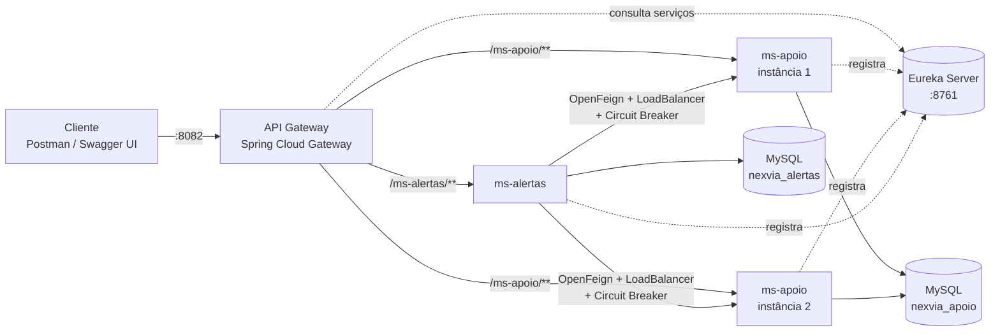
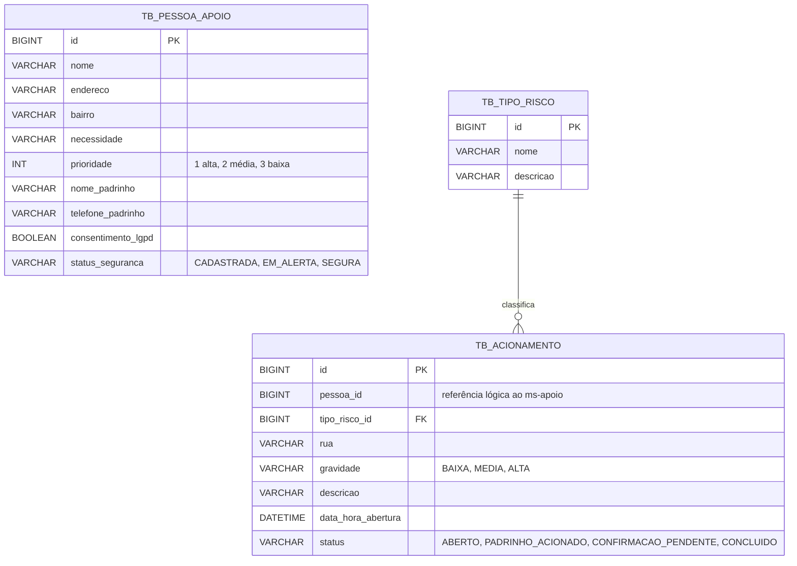
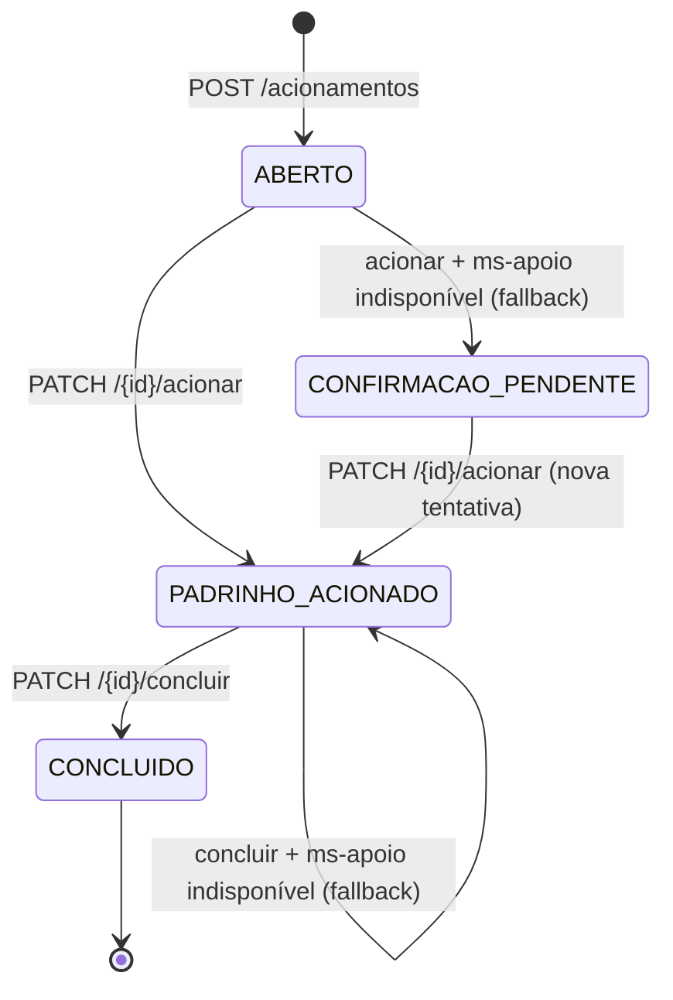
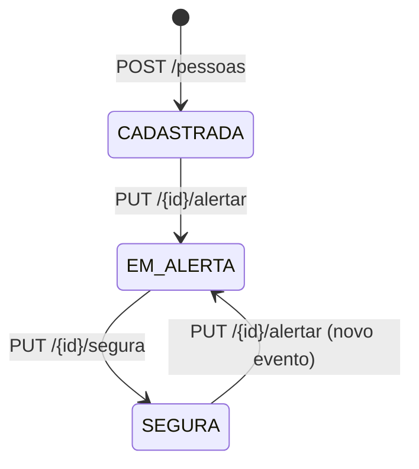
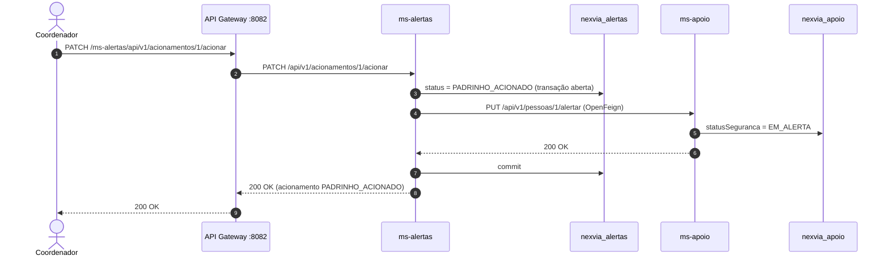
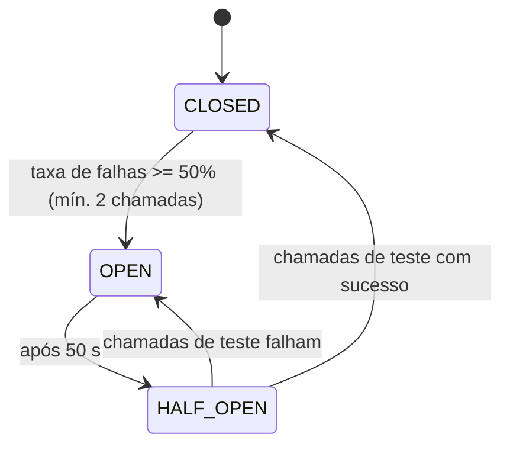
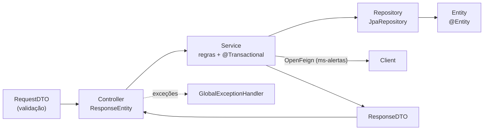

# NEXVIA — Documentação Técnica

Documento de referência de **como o projeto ficou** e **como ele funciona** por dentro.
Para executar e testar, veja o [Guia de Testes](GUIA_DE_TESTES.md).

**Sumário**

1. [Visão geral](#1-visão-geral)
2. [Arquitetura](#2-arquitetura)
3. [Componentes](#3-componentes)
4. [Modelo de dados](#4-modelo-de-dados)
5. [Ciclo de vida dos status](#5-ciclo-de-vida-dos-status)
6. [Comunicação síncrona (OpenFeign)](#6-comunicação-síncrona-openfeign)
7. [Resiliência: Circuit Breaker e Fallback](#7-resiliência-circuit-breaker-e-fallback)
8. [Contratos da API](#8-contratos-da-api)
9. [Tratamento de erros](#9-tratamento-de-erros)
10. [Persistência e migrations (Flyway)](#10-persistência-e-migrations-flyway)
11. [Configuração](#11-configuração)
12. [Organização do código](#12-organização-do-código)
13. [Atendimento aos requisitos da GS](#13-atendimento-aos-requisitos-da-gs)
14. [Decisões técnicas](#14-decisões-técnicas)

---

## 1. Visão geral

A NEXVIA garante que **pessoas que não conseguem evacuar sozinhas** (acamados, idosos que moram sozinhos, pessoas com deficiência, quem depende de aparelho elétrico) cheguem a um lugar seguro durante um evento climático extremo.

O sistema tem dois domínios, cada um em um microsserviço:

| Domínio | Microsserviço | Pergunta que responde |
| --- | --- | --- |
| **Apoio** | `ms-apoio` | *Quem precisa de ajuda, quem é o padrinho e essa pessoa já está segura?* |
| **Alertas** | `ms-alertas` | *Qual risco aconteceu, onde, e o padrinho já foi acionado? Já confirmou?* |

O **padrinho** é um vizinho ou familiar de referência, cadastrado junto com a pessoa, que vai até ela quando o alerta é confirmado.

Os dois serviços conversam de forma **síncrona** (HTTP via OpenFeign): quando um acionamento muda de estado no `ms-alertas`, o **status de segurança da pessoa** muda no `ms-apoio`.

---

## 2. Arquitetura



Como uma requisição percorre o sistema:

1. O cliente chama **sempre o Gateway** (`http://localhost:8082/<serviço>/<endpoint>`).
2. O Gateway consulta o **Eureka** para descobrir as instâncias registradas com aquele nome (Discovery Locator).
3. O **LoadBalancer** escolhe uma instância (round-robin) e encaminha a requisição, removendo o prefixo do serviço da URL.
4. A instância processa (Controller → Service → Repository → MySQL) e responde.
5. Quando o `ms-alertas` precisa alterar uma pessoa, ele chama o `ms-apoio` **pelo nome** (`@FeignClient("ms-apoio")`). Eureka e LoadBalancer resolvem a instância, sem nenhuma URL fixa.

Os microsserviços sobem em **porta aleatória** (`server.port=0`). Por isso é possível ter várias instâncias na mesma máquina, e o acesso é sempre pelo Gateway.

---

## 3. Componentes

| Componente | Porta | Tecnologia | Papel |
| --- | --- | --- | --- |
| `eureka-server` | **8761** | Spring Cloud Netflix Eureka Server | Registro e descoberta dos serviços |
| `api-gateway` | **8082** | Spring Cloud Gateway (WebFlux) + LoadBalancer + springdoc | Ponto único de entrada, roteamento dinâmico e Swagger unificado |
| `ms-apoio` | aleatória | Spring Boot (Web MVC, JPA, Validation, Flyway) + Eureka Client | Cadastro de pessoas, padrinhos e status de segurança |
| `ms-alertas` | aleatória | Spring Boot + OpenFeign + Resilience4j + Eureka Client | Acionamentos, tipos de risco e chamadas síncronas ao `ms-apoio` |
| MySQL | **3306** | MySQL 8.4.6 (Docker Compose) | Um banco independente por microsserviço |

Versões: **Java 25**, **Spring Boot 4.0.9**, **Spring Cloud 2025.1.4**, springdoc-openapi 3.1.0.

---

## 4. Modelo de dados

Cada microsserviço tem o **seu próprio banco**. Não existe chave estrangeira entre os serviços: o `ms-alertas` guarda apenas o `pessoaId` e consulta a pessoa no `ms-apoio` via OpenFeign.



| Banco | Tabela | Entidade JPA | Atributos |
| --- | --- | --- | --- |
| `nexvia_apoio` | `tb_pessoa_apoio` | `PessoaApoio` | 10 (inclui `statusSeguranca`) |
| `nexvia_alertas` | `tb_acionamento` | `Acionamento` | 8 (inclui `status`) |
| `nexvia_alertas` | `tb_tipo_risco` | `TipoRisco` (`@OneToMany` ↔ `@ManyToOne`) | 3 |

> `TB_PESSOA_APOIO` e `TB_ACIONAMENTO` estão em **bancos diferentes**: o diagrama mostra os dois lado a lado só como referência.

Os **tipos de risco ficam no banco** (carga via Flyway): um risco novo, como incêndio, entra com um `INSERT` e sem mudar o código.

---

## 5. Ciclo de vida dos status

O status **nunca** vem do cliente (não existe nos DTOs de Request). O service define o status inicial no cadastro, e ele só muda pelos endpoints de transição.

### Acionamento (`ms-alertas`)



### Pessoa (`ms-apoio`), alterado **somente pelo ms-alertas via OpenFeign**



### Regras de negócio

| Regra | Onde | Resposta |
| --- | --- | --- |
| Cadastro só com `consentimentoLgpd = true` | `PessoaApoioRequestDTO` (`@AssertTrue`) | 422 |
| Pessoa `EM_ALERTA` não pode ser alterada nem excluída | `PessoaApoioService` | 409 |
| Alertar uma pessoa que já está `EM_ALERTA` | `PessoaApoioService` | 409 |
| Marcar `SEGURA` uma pessoa que não está `EM_ALERTA` | `PessoaApoioService` | 409 |
| Acionamento só pode ser aberto para pessoa existente no `ms-apoio` | `AcionamentoService` (Feign) | 404 |
| Tipo de risco precisa existir | `AcionamentoService` | 409 |
| Acionar só com `ABERTO` ou `CONFIRMACAO_PENDENTE` | `AcionamentoService` | 409 |
| Concluir só com `PADRINHO_ACIONADO` | `AcionamentoService` | 409 |
| Editar acionamento só com `ABERTO` | `AcionamentoService` | 409 |
| Excluir acionamento com `PADRINHO_ACIONADO` é bloqueado | `AcionamentoService` | 409 |
| Lista de pessoas ordenada por prioridade (quem mais precisa primeiro) | `PessoaApoioRepository` | 200 |

---

## 6. Comunicação síncrona (OpenFeign)

O cliente fica em `ms-alertas/.../client/PessoaApoioClient.java`:

```java
@FeignClient("ms-apoio")   // nome no Eureka: sem URL fixa
public interface PessoaApoioClient {

    @RequestMapping(method = RequestMethod.GET,  value = "/api/v1/pessoas/{pessoaId}")
    PessoaApoioDTO buscarPessoa(@PathVariable Long pessoaId);

    @RequestMapping(method = RequestMethod.PUT,  value = "/api/v1/pessoas/{pessoaId}/alertar")
    void alertarPessoa(@PathVariable Long pessoaId);

    @RequestMapping(method = RequestMethod.PUT,  value = "/api/v1/pessoas/{pessoaId}/segura")
    void marcarPessoaSegura(@PathVariable Long pessoaId);
}
```

### Fluxo "acionar padrinho"



Como as respostas do `ms-apoio` são tratadas no `AcionamentoService`:

| Resposta do ms-apoio | Exceção no ms-alertas | Efeito |
| --- | --- | --- |
| 200 | — | Commit: os dois serviços ficam consistentes |
| 404 (pessoa não existe) | `ResourceNotFoundException` | Rollback, cliente recebe **404** |
| 409 (status incompatível) | `StatusInvalidoException` | Rollback, cliente recebe **409** |
| Falha de rede / sem instância / 5xx | `ComunicacaoException` | Rollback, o **Circuit Breaker** chama o fallback |

O status é gravado **antes** da chamada Feign, dentro de `@Transactional`. Se o Feign falhar, a exceção desfaz a alteração e nenhum serviço fica com estado "meio alterado".

---

## 7. Resiliência: Circuit Breaker e Fallback

O `@CircuitBreaker` fica na **controller** (`AcionamentoController`), nos dois endpoints que chamam o `ms-apoio`:

```java
@PatchMapping("/{id}/acionar")
@CircuitBreaker(name = "alterarStatusPessoa", fallbackMethod = "fallbackAcionarPadrinho")
public ResponseEntity<AcionamentoResponseDTO> acionarPadrinho(@PathVariable Long id) { ... }
```

| Endpoint | Fallback | Resultado no fallback |
| --- | --- | --- |
| `PATCH /{id}/acionar` | `fallbackAcionarPadrinho` | Acionamento vai para `CONFIRMACAO_PENDENTE` (para escalonamento) e responde **503** com o corpo |
| `PATCH /{id}/concluir` | `fallbackConcluirAcionamento` | Mantém `PADRINHO_ACIONADO` (a confirmação pode ser reenviada) e responde **503** com o corpo |

Os erros de negócio (`ResourceNotFoundException` e `StatusInvalidoException`) são **repassados** pelo fallback ao `GlobalExceptionHandler` (404 ou 409) e estão em `ignoreExceptions`. Assim eles **não contam como falha** e não abrem o circuito.

Configuração (`ms-alertas/src/main/resources/application.properties`):

| Propriedade | Valor | Significado |
| --- | --- | --- |
| `slidingWindowType` | `COUNT_BASED` | Janela por quantidade de chamadas |
| `slidingWindowSize` | `3` | Observa as últimas 3 chamadas |
| `minimumNumberOfCalls` | `2` | Só calcula a taxa de falha após 2 chamadas |
| `failureRateThreshold` | `50` | Abre o circuito com 50% de falhas |
| `waitDurationInOpenState` | `50s` | Tempo em `OPEN` antes de ir para `HALF_OPEN` |
| `permittedNumberOfCallsInHalfOpenState` | `2` | Chamadas de teste em `HALF_OPEN` |



Com o circuito `OPEN`, as chamadas nem chegam a sair: o fallback responde na hora, e o log mostra `CircuitBreaker 'alterarStatusPessoa' is OPEN and does not permit further calls`.

---

## 8. Contratos da API

Todos os endpoints são **versionados** em `/api/v1/...` e acessados pelo Gateway com o prefixo do serviço:
`http://localhost:8082/ms-apoio/api/v1/...` e `http://localhost:8082/ms-alertas/api/v1/...`.

### 8.1 ms-apoio: `/api/v1/pessoas`

| Método | Rota | Request | Response | Sucesso |
| --- | --- | --- | --- | --- |
| GET | `/api/v1/pessoas` | `?status=` (opcional) | `List<PessoaApoioResponseDTO>` | 200 |
| GET | `/api/v1/pessoas/{id}` | — | `PessoaApoioResponseDTO` | 200 |
| POST | `/api/v1/pessoas` | `PessoaApoioRequestDTO` | `PessoaApoioResponseDTO` + header `Location` | 201 |
| PUT | `/api/v1/pessoas/{id}` | `PessoaApoioRequestDTO` | `PessoaApoioResponseDTO` | 200 |
| DELETE | `/api/v1/pessoas/{id}` | — | — | 204 |
| PUT | `/api/v1/pessoas/{id}/alertar` | — | `PessoaApoioResponseDTO` | 200 |
| PUT | `/api/v1/pessoas/{id}/segura` | — | `PessoaApoioResponseDTO` | 200 |
| GET | `/api/v1/pessoas/port` | — | texto com a porta da instância | 200 |

**PessoaApoioRequestDTO** (entrada, sem `id` e sem status):

| Campo | Tipo | Validação |
| --- | --- | --- |
| `nome` | String | obrigatório, 3–100 |
| `endereco` | String | obrigatório, 5–150 |
| `bairro` | String | obrigatório, 3–80 |
| `necessidade` | String | obrigatório, 5–255 |
| `prioridade` | Integer | obrigatório, 1 a 3 |
| `nomePadrinho` | String | obrigatório, 3–100 |
| `telefonePadrinho` | String | obrigatório, 10 ou 11 dígitos |
| `consentimentoLgpd` | Boolean | obrigatório e **true** |

```json
{
  "nome": "Maria Aparecida dos Santos",
  "endereco": "Rua das Palmeiras, 120 - casa 2",
  "bairro": "Morro da Esperança",
  "necessidade": "Acamada, 82 anos, usa concentrador de oxigênio",
  "prioridade": 1,
  "nomePadrinho": "João Pereira",
  "telefonePadrinho": "11987654321",
  "consentimentoLgpd": true
}
```

**PessoaApoioResponseDTO** (saída): todos os campos acima + `id` + `statusSeguranca`.

### 8.2 ms-alertas: `/api/v1/acionamentos` e `/api/v1/tipos-risco`

| Método | Rota | Request | Response | Sucesso |
| --- | --- | --- | --- | --- |
| GET | `/api/v1/acionamentos` | — | `List<AcionamentoResponseDTO>` | 200 |
| GET | `/api/v1/acionamentos/{id}` | — | `AcionamentoResponseDTO` | 200 |
| POST | `/api/v1/acionamentos` | `AcionamentoRequestDTO` | `AcionamentoResponseDTO` + header `Location` | 201 |
| PUT | `/api/v1/acionamentos/{id}` | `AcionamentoRequestDTO` | `AcionamentoResponseDTO` | 200 |
| DELETE | `/api/v1/acionamentos/{id}` | — | — | 204 |
| PATCH | `/api/v1/acionamentos/{id}/acionar` | — | `AcionamentoResponseDTO` | 200 / 503 |
| PATCH | `/api/v1/acionamentos/{id}/concluir` | — | `AcionamentoResponseDTO` | 200 / 503 |
| GET | `/api/v1/tipos-risco` | — | `List<TipoRiscoResponseDTO>` | 200 |
| GET | `/api/v1/tipos-risco/port` | — | texto com a porta da instância | 200 |

**AcionamentoRequestDTO**:

| Campo | Tipo | Validação |
| --- | --- | --- |
| `pessoaId` | Long | obrigatório, positivo, precisa existir no `ms-apoio` |
| `tipoRiscoId` | Long | obrigatório, precisa existir em `tb_tipo_risco` |
| `rua` | String | obrigatório, 3–150 |
| `gravidade` | Enum | obrigatório: `BAIXA`, `MEDIA` ou `ALTA` |
| `descricao` | String | obrigatório, 10–255 |

```json
{
  "pessoaId": 1,
  "tipoRiscoId": 1,
  "rua": "Rua das Palmeiras",
  "gravidade": "ALTA",
  "descricao": "Três moradores relatam rachaduras na encosta atrás das casas"
}
```

**AcionamentoResponseDTO**:

```json
{
  "id": 1,
  "pessoaId": 1,
  "tipoRisco": { "id": 1, "nome": "Deslizamento", "descricao": "Rachaduras no solo, árvores ou postes inclinados, estalos na encosta" },
  "rua": "Rua das Palmeiras",
  "gravidade": "ALTA",
  "descricao": "Três moradores relatam rachaduras na encosta atrás das casas",
  "dataHoraAbertura": "2026-11-10T22:00:00",
  "status": "ABERTO"
}
```

> Os campos do JSON aparecem em ordem alfabética nas respostas: é o padrão do Jackson 3, usado pelo Spring Boot 4. Isso não muda o conteúdo.

---

## 9. Tratamento de erros

Cada microsserviço tem um `GlobalExceptionHandler` (`@RestControllerAdvice`) que devolve sempre o mesmo formato:

```json
{
  "timestamp": "2026-11-11T22:33:04.765Z",
  "status": 409,
  "error": "Pessoa id 1 está EM_ALERTA e não pode ser alterada",
  "path": "/api/v1/pessoas/1"
}
```

Erros de validação (422) incluem a lista de campos:

```json
{
  "timestamp": "2026-11-11T22:33:04.893Z",
  "status": 422,
  "error": "Dados inválidos",
  "path": "/api/v1/pessoas",
  "errors": [
    { "fieldName": "telefonePadrinho", "message": "O telefone do padrinho deve ter 10 ou 11 dígitos (somente números, com DDD)" },
    { "fieldName": "consentimentoLgpd", "message": "O cadastro só pode ser feito com o consentimento da pessoa ou do responsável (LGPD)" }
  ]
}
```

| HTTP | Exceção | Exemplo |
| --- | --- | --- |
| 400 | `HttpMessageNotReadableException` | JSON malformado, `"gravidade": "ENORME"` |
| 400 | `MethodArgumentTypeMismatchException` | `/pessoas/abc`, `?status=INVALIDO` |
| 404 | `ResourceNotFoundException` | ID inexistente; pessoa inexistente no `ms-apoio` |
| 409 | `PessoaEmAlertaException` (ms-apoio) | alterar ou excluir pessoa `EM_ALERTA` |
| 409 | `StatusInvalidoException` | transição de status não permitida |
| 409 | `DatabaseException` (ms-alertas) | tipo de risco inexistente |
| 422 | `MethodArgumentNotValidException` | falha de Bean Validation |
| 503 | `ComunicacaoException` / fallback | `ms-apoio` indisponível |

---

## 10. Persistência e migrations (Flyway)

O Hibernate **não cria tabelas** (`spring.jpa.hibernate.ddl-auto=none`). A estrutura e a carga inicial vêm só das migrations do Flyway, em `src/main/resources/db/migration`, com o padrão de nome `V<versão>__<descrição>.sql`:

| Serviço | Migration | Conteúdo |
| --- | --- | --- |
| ms-apoio | `V1__create_table_tb_pessoa_apoio.sql` | Cria `tb_pessoa_apoio` |
| ms-apoio | `V2__insert_tb_pessoa_apoio.sql` | 5 pessoas (fictícias) |
| ms-alertas | `V1__create_table_tb_tipo_risco.sql` | Cria `tb_tipo_risco` |
| ms-alertas | `V2__insert_tb_tipo_risco.sql` | 5 tipos de risco |
| ms-alertas | `V3__create_table_tb_acionamento.sql` | Cria `tb_acionamento` (FK para `tb_tipo_risco`) |
| ms-alertas | `V4__insert_tb_acionamento.sql` | 3 acionamentos |

### Carga inicial

**Pessoas (`nexvia_apoio`)**

| id | Nome | Necessidade | Prioridade | Padrinho | Status |
| --- | --- | --- | --- | --- | --- |
| 1 | Maria Aparecida dos Santos | Acamada, 82 anos, usa concentrador de oxigênio | 1 | João Pereira | CADASTRADA |
| 2 | Antônio Carlos Ribeiro | Cadeirante, 77 anos, mora sozinho | 1 | Luciana Ribeiro | CADASTRADA |
| 3 | Ana Beatriz Souza | Pessoa surda: aviso somente por SMS | 2 | Carlos Mendes | SEGURA |
| 4 | Benedita Lima | Idosa, 85 anos, mobilidade reduzida | 2 | Patrícia Lima | CADASTRADA |
| 5 | Rafael Nogueira | Deficiência visual | 3 | Marcos Nogueira | CADASTRADA |

**Tipos de risco (`nexvia_alertas`)**: 1 Deslizamento · 2 Alagamento · 3 Enxurrada · 4 Queda de energia · 5 Incêndio

**Acionamentos (`nexvia_alertas`)**

| id | pessoaId | Tipo | Rua | Gravidade | Status |
| --- | --- | --- | --- | --- | --- |
| 1 | 1 (Dona Maria) | Deslizamento | Rua das Palmeiras | ALTA | ABERTO |
| 2 | 4 (Benedita) | Alagamento | Rua Beira-Rio | MEDIA | ABERTO |
| 3 | 3 (Ana) | Alagamento | Rua das Palmeiras | MEDIA | CONCLUIDO (simulado anterior) |

Os dados das duas bases são **coerentes entre si**: a Ana está `SEGURA` porque o acionamento 3 dela foi concluído.

O Flyway registra o que já executou na tabela `flyway_schema_history` de cada banco. Por isso, nas próximas inicializações, nada é reexecutado.

---

## 11. Configuração

### Eureka e porta aleatória (os dois microsserviços)

```properties
spring.application.name=ms-apoio                 # nome usado no Eureka, no Gateway e no Feign
spring.profiles.active=dev                       # carrega application-dev.properties (MySQL)
eureka.client.serviceUrl.defaultZone=http://localhost:8761/eureka/
server.port=0                                    # porta aleatória -> múltiplas instâncias
eureka.instance.instance-id=${spring.application.name}:${random.int[1,99]}
```

### MySQL e Flyway (`application-dev.properties`)

```properties
spring.datasource.url=jdbc:mysql://localhost:3306/nexvia_apoio?createDatabaseIfNotExist=true&useTimezone=true&serverTimezone=UTC
spring.datasource.username=root
spring.datasource.password=root
spring.flyway.enabled=true
spring.flyway.locations=classpath:db/migration
spring.jpa.hibernate.ddl-auto=none
```

### Gateway

```properties
server.port=8082
spring.cloud.gateway.server.webflux.discovery.locator.enabled=true            # rotas automáticas via Eureka
spring.cloud.gateway.server.webflux.discovery.locator.lower-case-service-id=true
```

### Perfis

| Perfil | Onde | Uso |
| --- | --- | --- |
| `dev` | `src/main/resources/application-dev.properties` | Execução normal com MySQL (ativo por padrão) |
| `test` | `src/test/resources/application-test.properties` | Testes `contextLoads`: H2 em memória, sem Eureka e sem Flyway |

---

## 12. Organização do código

Os microsserviços seguem a **arquitetura em camadas** ensinada na disciplina. A controller **nunca** acessa o repository.



| Pacote | ms-apoio | ms-alertas |
| --- | --- | --- |
| `controller` | `PessoaApoioController` | `AcionamentoController`, `TipoRiscoController` |
| `service` | `PessoaApoioService` | `AcionamentoService`, `TipoRiscoService` |
| `repositories` | `PessoaApoioRepository` | `AcionamentoRepository`, `TipoRiscoRepository` |
| `entities` | `PessoaApoio`, `StatusSeguranca` | `Acionamento`, `TipoRisco`, `StatusAcionamento`, `Gravidade` |
| `dto` | `PessoaApoioRequestDTO`, `PessoaApoioResponseDTO` | `AcionamentoRequestDTO`, `AcionamentoResponseDTO`, `TipoRiscoResponseDTO`, `PessoaApoioDTO` |
| `client` | — | `PessoaApoioClient` (OpenFeign) |
| `exceptions` | `ResourceNotFound`, `PessoaEmAlerta`, `StatusInvalido` + `dto/` + `handler/` | `ResourceNotFound`, `StatusInvalido`, `Database`, `Comunicacao` + `dto/` + `handler/` |
| `config` | `OpenApiConfig` | `OpenApiConfig` |

Histórico de commits (uma etapa por commit, cada uma compilando):

```
chore: estrutura inicial do monorepo e MySQL com Docker Compose
feat(eureka-server): Eureka Server na porta 8761
feat(api-gateway): API Gateway na porta 8082 com Discovery Locator e Load Balancer
feat(ms-apoio): projeto base -> entidade + Flyway -> repository + DTOs -> service -> controller
feat(ms-alertas): projeto base -> entidades + Flyway -> repositories + DTOs -> Feign -> service -> controllers + Circuit Breaker
docs: Swagger/OpenAPI, README, documentação
```

---

## 13. Atendimento aos requisitos da GS

| # | Critério | Como foi atendido | Onde |
| --- | --- | --- | --- |
| 1 | Eureka 8761, Gateway 8082, OpenFeign, Load Balancer, Circuit Breaker, Fallback, sem URLs fixas, múltiplas instâncias | `@EnableEurekaServer`, Discovery Locator, `@FeignClient("ms-apoio")`, `spring-cloud-starter-loadbalancer`, `@CircuitBreaker` + `fallbackMethod`, `server.port=0` | `eureka-server`, `api-gateway`, `ms-alertas/client`, `AcionamentoController` |
| 2 | Entidades com ≥ 5 atributos e status alterado via comunicação síncrona | `PessoaApoio` (10 atributos, `statusSeguranca`), `Acionamento` (8, `status`) | `entities/` |
| 3 | DTOs de Request e Response, sem expor entidades | `*RequestDTO` / `*ResponseDTO` em todos os endpoints | `dto/` |
| 4 | Repository, banco próprio por serviço, Flyway para tabelas e carga | `JpaRepository`, `nexvia_apoio` / `nexvia_alertas`, `V1..V4` | `repositories/`, `db/migration/` |
| 5 | Service com CRUD completo e exceções customizadas | `findAll`, `findById`, `save`, `update`, `delete` + regras de status | `service/`, `exceptions/` |
| 6 | Controller com CRUD, alteração de status, `ResponseEntity`, códigos HTTP e URI no POST | `ResponseEntity.created(uri)`, `noContent()`, 400/404/409/422/503 | `controller/` |
| 7 | Versionamento `/api/v1` | `@RequestMapping("/api/v1/...")` em todas as controllers | `controller/` |
| 8 | Porta aleatória, MySQL, sobe sem alterar o código | `server.port=0`, `application-dev.properties`, `createDatabaseIfNotExist` | `resources/` |
| 9 | Swagger/OpenAPI | springdoc + `OpenApiConfig` + Swagger dinâmico no Gateway | `config/` |
| 10 | README com integrantes, problema, solução e execução com Docker | `README.md` + `docs/` | raiz |

---

## 14. Decisões técnicas

| Decisão | Motivo |
| --- | --- |
| Quatro serviços da ideia original agrupados em **dois** (`ms-apoio` e `ms-alertas`) | A GS pede dois microsserviços. `ms-usuarios` ficou dentro de `ms-apoio`, e `ms-relatos` dentro de `ms-alertas` |
| Spring Boot **4.0.9** também no Eureka e no Gateway | Os projetos da aula vinham em versões diferentes. Padronizar evita incompatibilidade de Spring Cloud |
| `spring-boot-starter-flyway` e `spring-boot-starter-aspectj` | No Spring Boot 4 a autoconfiguração do Flyway e o suporte a AOP (usado pela anotação `@CircuitBreaker`) ficam em starters próprios |
| Erros de negócio repassados pelo fallback e listados em `ignoreExceptions` | Um 404 ou 409 legítimo não deve virar 503 nem abrir o circuito |
| Status gravado antes da chamada Feign, dentro da transação | Se o `ms-apoio` falhar, o rollback evita estado inconsistente entre os serviços |
| Um único MySQL com **dois bancos** | Segue o Docker Compose da aula (`mysql:8.4.6`) e atende "banco próprio, sem compartilhar schema ou tabelas" |
| URI do POST aponta para a instância que respondeu | Padrão `ServletUriComponentsBuilder.fromCurrentRequestUri()` das aulas. Apontar para o Gateway exigiria configurar *trusted proxies*, fora do conteúdo da disciplina |
| Perfil `test` com H2 só em `src/test` | O build (`mvnw package`) roda os testes sem precisar do MySQL nem do Eureka |
